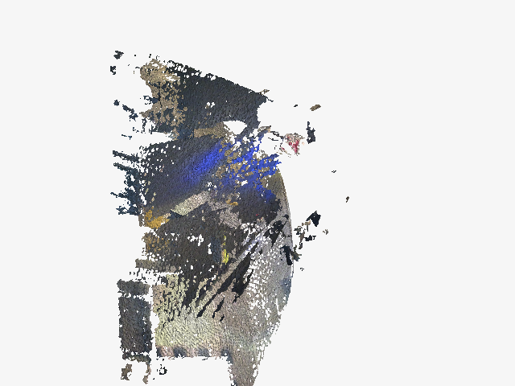
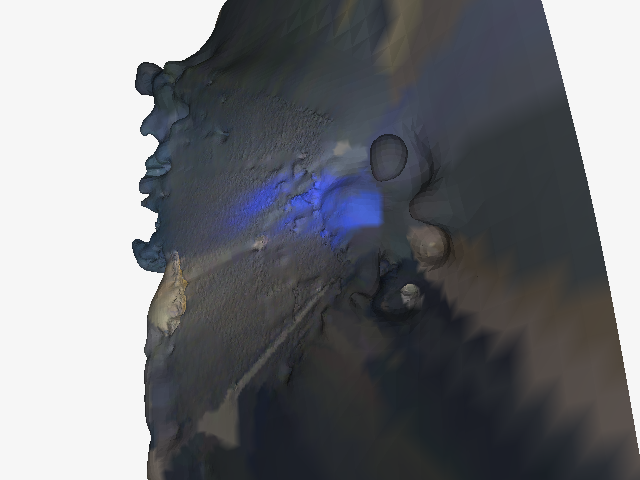
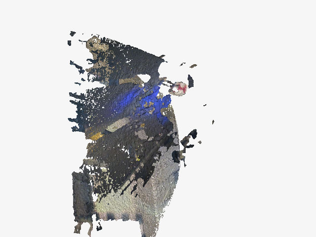
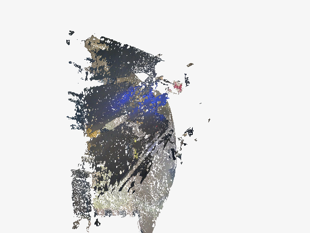
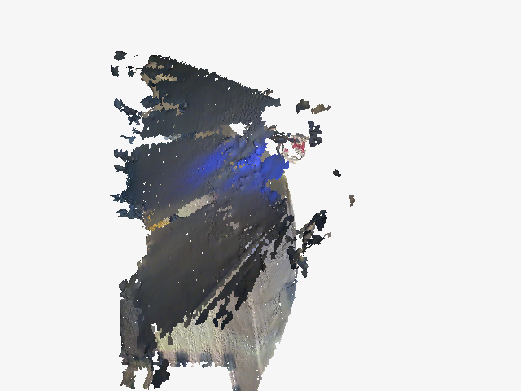
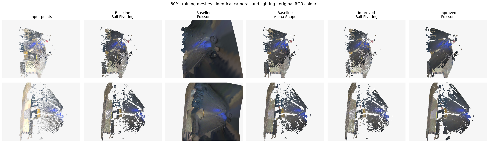
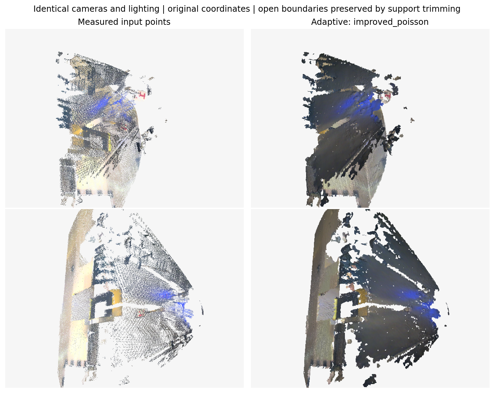

# Meshing Toolkit

Reconstruct coloured, open surface meshes from PCD/PLY point clouds. Production
uses **Improved Ball Pivoting** and **Improved Poisson** only. The three basic
methods are kept exclusively in the [five-method benchmark](benchmark/README.md).


**Improved Poisson is recommended for the three real captures.** It was selected
for every capture using held-out scan consistency and surface support. For new
datasets, `auto` compares only the two improved methods and selects per input.
Both retain the original point-cloud colours as vertex RGB in the saved PLY.

## Benchmark results and examples

All five methods use the same 80% training / 20% held-out split on each capture.
These are equal-weight averages across the three captures. Higher coverage is
better; lower distance, unsupported area, and score are better.

<!-- BENCHMARK_TABLE_START -->
| Method | Coverage ↑ | p95 / local spacing ↓ | Unsupported area ↓ | Score ↓ | Colour sample |
| --- | ---: | ---: | ---: | ---: | --- |
| Baseline Ball Pivoting | 87.8% | 3.48 | 0.28% | 3.90 |  |
| Baseline Poisson | 95.9% | 1.86 | 69.28% | 4.76 |  |
| Baseline Alpha Shape | 91.4% | 3.00 | 1.52% | 3.33 |  |
| Improved Ball Pivoting | 94.1% | 2.14 | 0.06% | 2.40 |  |
| Improved Poisson | 96.0% | 1.86 | 0.15% | 1.99 |  |
<!-- BENCHMARK_TABLE_END -->

The p95 distance is divided by local training-point spacing. Unsupported area
measures reconstructed surface beyond the sampled input support. This explains
why basic Poisson can cover input points well while adding large unwanted sheets.

[Full results, methodology, topology and runtimes](benchmark/README.md) ·
[CSV measurements](benchmark/results.csv) · [Detailed JSON](benchmark/results.json) ·
[Download coloured sample meshes](benchmark/samples/)

Click the figure for the full-size comparison. All columns use identical cameras
and lighting; two viewpoints expose both sides of the scene.

<a href="benchmark/figures/capture_1_colours.png"></a>

[Capture 2](benchmark/figures/capture_2_colours.png) ·
[Capture 3](benchmark/figures/capture_3_colours.png) ·
[Uniform shading for geometry comparison](benchmark/figures/capture_1_geometry.png)

### Final recommended result

This is the selected **Improved Poisson**, refit using all valid capture_1 points.
It preserves measured colours and open boundaries after support trimming.



[Download the final recommended colour sample](benchmark/samples/capture_1_final_recommended.ply).
Published samples are reduced to at most 60,000 triangles for download; full local
meshes are used for all measurements. These are vertex-coloured meshes, without
external textures. Open them in a viewer that displays vertex RGB.

## Setup and production usage

Use Python 3.9+:

```bash
python -m pip install -r requirements.txt
python -m reconstruction.cli --dry-run
python -m reconstruction.cli
```

Edit [`config/meshing.ini`](config/meshing.ini):

```ini
[general]
input_path = ../datasets/captures
reconstruction_method = auto
output_dir =
extensions = .pcd
recursive = true
skip_existing = true
```

Production choices are `auto`, `improved_ball_pivoting`, and `improved_poisson`.
`auto` compares the two improved methods; the three baselines cannot be selected.
Paths in the INI resolve relative to its location. Leave `output_dir` empty to
save beside each source. An override mirrors the dataset and source subfolders
under your chosen root. Use `skip_existing = false` after changing parameters.

For a fresh run on one file or a dataset folder:

```bash
python -m reconstruction.adaptive --input datasets/captures --method auto
python -m reconstruction.adaptive --input datasets/captures/capture_1.pcd --method improved_poisson
python -m reconstruction.adaptive --input datasets/captures/capture_1.pcd --method improved_ball_pivoting
```

The direct command always creates a new timestamped run. Both entry points save
a colour PLY, JSON quality/selection report, and colour PNG preview. Existing
successful auto results are skipped by the batch CLI. A manually forced method
does not prevent a later auto comparison.

## How the improved methods work

1. Remove nonfinite and duplicate points; normalize coordinates for stability.
2. Estimate local point spacing, reject isolated noise, and regularize sampling
   within a point budget. Gently denoise local planes while protecting edges.
3. Estimate locally consistent normals without assuming a scanner at the origin.
4. Compare **Improved Ball Pivoting** (three spacing-derived radii) and
   **Improved Poisson** (two spacing-derived resolutions) on held-out points.
5. Trim triangles unsupported by nearby measurements, checking vertices,
   midpoints, and triangle interiors. Retain open boundaries and separate patches.
6. Repair topology, select using distance/support/fragment quality, and refit on
   all valid points. Transfer original RGB to the final surface and verify colour
   survives saving and reloading.

Nearly tied candidates favor fewer triangles. `[adaptive]` controls point budget,
neighbor count, denoising, voxel size relative to spacing, support tolerance,
Poisson depth cap, and threads. No dataset coordinates or physical units are
hard-coded. The minimum is 100 distinct finite points.

## Folder structure

```text
Meshing/
├── reconstruction/                    Production improved methods and CLI
├── config/meshing.ini
├── datasets/
│   ├── captures/
│   │   ├── capture_1.pcd
│   │   └── capture_1/
│   │       ├── meshes/
│   │       │   ├── improved_ball_pivoting/   PLY + JSON + PNG when selected/forced
│   │       │   └── improved_poisson/        PLY + JSON + PNG when selected/forced
│   │       └── benchmark/
│   │           ├── baseline_ball_pivoting/  Full validation mesh (local)
│   │           ├── baseline_poisson/
│   │           ├── baseline_alpha_shape/
│   │           ├── improved_ball_pivoting/
│   │           ├── improved_poisson/
│   │           └── previous_adaptive/      Earlier comparison runs (local)
│   ├── scans/
│   ├── combined_clouds/
│   └── legacy/                         Older meshes with unknown inputs
├── benchmark/                          Published benchmark, separate from production
│   ├── baselines.py                    Basic methods live only here
│   ├── run.py
│   ├── README.md
│   ├── results.csv / results.json
│   ├── figures/                        Resized in this README; full PNGs available
│   └── samples/                        Colour PLY from each of the five methods
├── docs/asset-migration.csv
├── tests/
└── requirements.txt
```

Outputs are grouped by dataset, input stem, and method. There are no library-named
output folders. Previous baseline meshes were moved into per-input benchmark
folders; original point clouds and finished mesh assets are preserved. See
[dataset notes](datasets/README.md). Raw clouds and full generated meshes stay
local and are ignored by Git. Benchmark reports, figures, and compact colour
samples are included in Git for viewing on GitHub.

## Run the benchmark

```bash
python -m benchmark.run
```

Runs baseline Ball Pivoting, baseline Poisson, baseline Alpha Shape, Improved Ball
Pivoting, and Improved Poisson on the three real captures. Saves all five full
validation meshes inside each capture's benchmark folder, publishes figures and
samples under `benchmark/`, and refits the winning improved method for production.
See the [benchmark protocol](benchmark/README.md#protocol-and-interpretation).
The original raw captures must be present locally to reproduce the results.

The published numbers measure consistency with withheld scan points, not
ground-truth accuracy. The improved Poisson resolution uses the same holdout for
selection, so this is not an independent test set. These captures share a similar
scene; the recommendation does not establish performance on every future cloud.
Missing geometry and gaps smaller than local sampling remain ambiguous.

The reconstruction and distance operations use Open3D's
[surface reconstruction](https://www.open3d.org/docs/release/tutorial/geometry/surface_reconstruction.html)
and [unsigned distance queries](https://www.open3d.org/docs/latest/tutorial/geometry/distance_queries.html).

## Verification

```bash
python -m unittest discover -s tests -v
```

Checks include holes, sharp corners, curved surfaces, noise, scale/translation,
topology, output discovery, rejection of production baselines, colour placement
after PLY round-trips for both improved methods and all baselines, and matching
point/mesh preview cameras.
