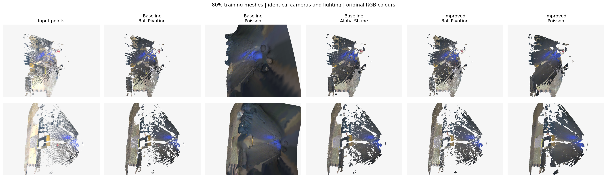
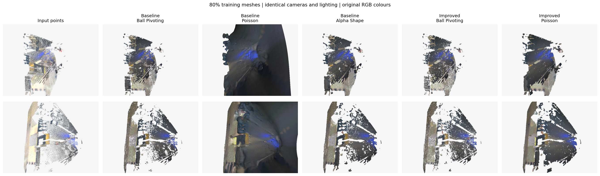
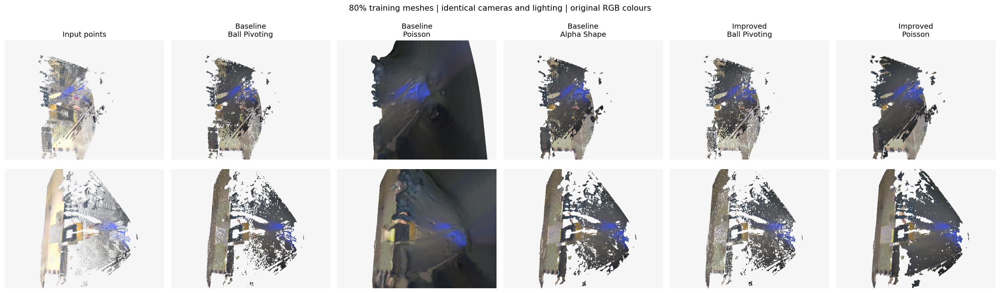
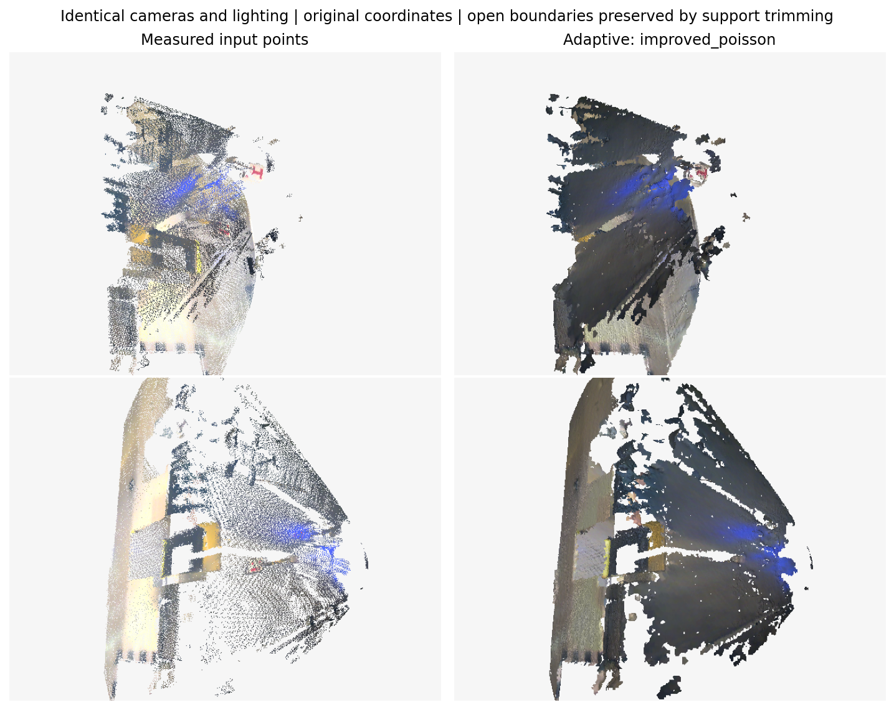

# Meshing benchmark

**Recommendation: Improved Poisson**, selected for 3 of 3 real captures. Production selection considers only the two improved methods.


## Five-method comparison

These are equal-weight averages across captures. Lower score is better; open boundaries are not penalized.

| Method | Coverage ↑ | p95 / local spacing ↓ | Unsupported area ↓ | Score ↓ |
| --- | ---: | ---: | ---: | ---: |
| Baseline Ball Pivoting | 87.8% | 3.48 | 0.28% | 3.90 |
| Baseline Poisson | 95.9% | 1.86 | 69.28% | 4.76 |
| Baseline Alpha Shape | 91.4% | 3.00 | 1.52% | 3.33 |
| Improved Ball Pivoting | 94.1% | 2.14 | 0.06% | 2.40 |
| Improved Poisson | 96.0% | 1.86 | 0.15% | 1.99 |

## Per-capture results

| Capture | Method | Coverage | p95 distance (input units) | Unsupported surface | Score | Faces |
| --- | --- | ---: | ---: | ---: | ---: | ---: |
| capture_1 | Baseline Ball Pivoting | 89.2% | 0.02372 | 0.22% | 3.451 | 122,927 |
| capture_1 | Baseline Poisson | 95.8% | 0.01765 | 70.44% | 4.836 | 388,364 |
| capture_1 | Baseline Alpha Shape | 91.6% | 0.01914 | 1.47% | 3.230 | 170,968 |
| capture_1 | Improved Ball Pivoting | 94.0% | 0.01843 | 0.07% | 2.420 | 161,276 |
| capture_1 | Improved Poisson | 95.8% | 0.01722 | 0.14% | 2.012 | 324,693 |
| capture_2 | Baseline Ball Pivoting | 84.9% | 0.02527 | 0.29% | 4.854 | 117,775 |
| capture_2 | Baseline Poisson | 95.6% | 0.01784 | 69.62% | 4.838 | 375,533 |
| capture_2 | Baseline Alpha Shape | 89.8% | 0.02173 | 1.42% | 4.022 | 168,724 |
| capture_2 | Improved Ball Pivoting | 93.6% | 0.01858 | 0.04% | 2.521 | 159,189 |
| capture_2 | Improved Poisson | 95.7% | 0.01745 | 0.21% | 2.043 | 317,917 |
| capture_3 | Baseline Ball Pivoting | 89.2% | 0.02289 | 0.32% | 3.396 | 122,473 |
| capture_3 | Baseline Poisson | 96.5% | 0.01751 | 67.80% | 4.604 | 387,482 |
| capture_3 | Baseline Alpha Shape | 93.0% | 0.01793 | 1.67% | 2.727 | 172,598 |
| capture_3 | Improved Ball Pivoting | 94.9% | 0.01844 | 0.06% | 2.264 | 163,217 |
| capture_3 | Improved Poisson | 96.5% | 0.01729 | 0.10% | 1.902 | 329,378 |

[Download measurements (CSV)](results.csv) · [Parameters, hashes, variants and topology (JSON)](results.json)

## Visual comparisons

Each figure shows the same two cameras for the input and all five training meshes. Colour figures display the retained RGB; geometry figures use uniform shading. Click an image for full resolution.

### capture_1

<a href="figures/capture_1_colours.png"></a>

[Uniform geometry comparison](figures/capture_1_geometry.png)

### capture_2

<a href="figures/capture_2_colours.png"></a>

[Uniform geometry comparison](figures/capture_2_geometry.png)

### capture_3

<a href="figures/capture_3_colours.png"></a>

[Uniform geometry comparison](figures/capture_3_geometry.png)

## Downloadable colour samples

Samples use capture_1 and are reduced to at most 60,000 triangles for a small GitHub download. All retain vertex RGB. They are presentation examples; the measurements above use the original, unreduced training meshes.

| Method | PLY sample |
| --- | --- |
| Baseline Ball Pivoting | [Download](samples/capture_1_baseline_ball_pivoting.ply) |
| Baseline Poisson | [Download](samples/capture_1_baseline_poisson.ply) |
| Baseline Alpha Shape | [Download](samples/capture_1_baseline_alpha_shape.ply) |
| Improved Ball Pivoting | [Download](samples/capture_1_improved_ball_pivoting.ply) |
| Improved Poisson | [Download](samples/capture_1_improved_poisson.ply) |

[Final recommended full-input refit, reduced colour sample](samples/capture_1_final_recommended.ply)



## Reproduce

```bash
python -m benchmark.run
```

Defaults to the three real files in `datasets/captures/`. Full benchmark meshes are saved locally under `<capture>/benchmark/<method>/validation_mesh.ply`. The selected improved method is refit on all valid points and saved under `<capture>/meshes/<method>/`. Figures, measurements, and compact samples are saved here. Raw input clouds and full meshes remain local.

## Protocol and interpretation

- One fixed seed-42 split: 80% of distinct finite input points for reconstruction, 20% withheld. All five methods use the same split and the same evaluation points. A deterministic 20,000-point subset limits metric cost.
- Baselines receive conventional KNN=30 normals with tangent-plane orientation; no denoising or support trimming. Ball Pivoting uses one radius, 2.5 times mean nearest-neighbor distance. Baseline Poisson uses depth 9 and scale 1.1. Alpha Shape uses alpha 5 times median nearest-neighbor spacing. These are declared reference settings, not exhaustive tuning of each baseline.
- Improved methods share scale-aware denoising, locally oriented normals, locally scaled support trimming, topology cleanup, and colour transfer. Ball Pivoting uses three radii; Poisson tests two spacing-derived resolutions. The best Poisson resolution uses the same holdout; these are selection-consistency results, not an independent test set.
- Coverage: proportion of withheld samples within two local spacings of a triangle. p95: 95th percentile unsigned point-to-triangle distance. Unsupported surface: fraction of area-weighted surface samples farther than 2.5 local spacings from training points.
- Score = p95 distance/local spacing + 3×uncovered fraction + 4×unsupported fraction + 2×tiny-component area fraction + 0.5×sliver area fraction. Scores within 3% or 0.01 favor fewer triangles. Boundary counts are reported but do not force closed solids.
- Runtime includes each method's preparation, reconstruction and evaluation. Improved Poisson includes both candidate resolutions; file saving, preview rendering and full-input refitting are excluded. Preparation is reused during execution but charged to each method.
- Colours are transferred from training points for measured meshes; final refits and presentation samples use the original input RGB. Binary PLY stores RGB at 8-bit precision. There are no external texture files.
- Input units are not assumed to be metres. These three captures depict a similar scene; measured scan consistency does not establish ground-truth accuracy or performance on every dataset.
